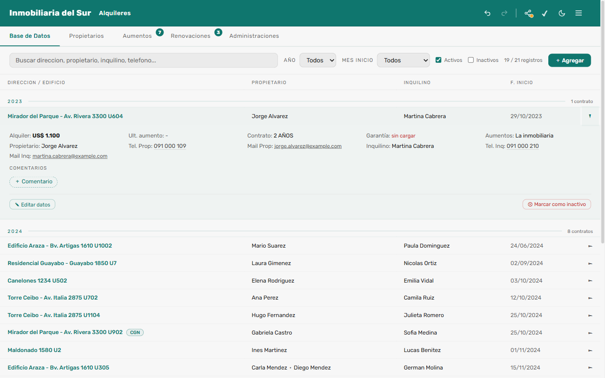
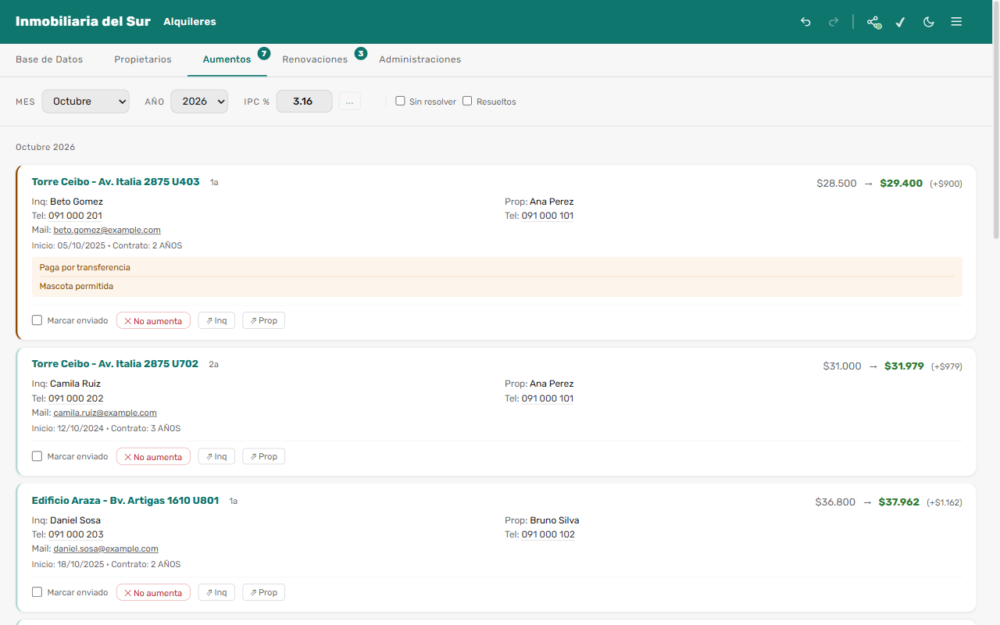
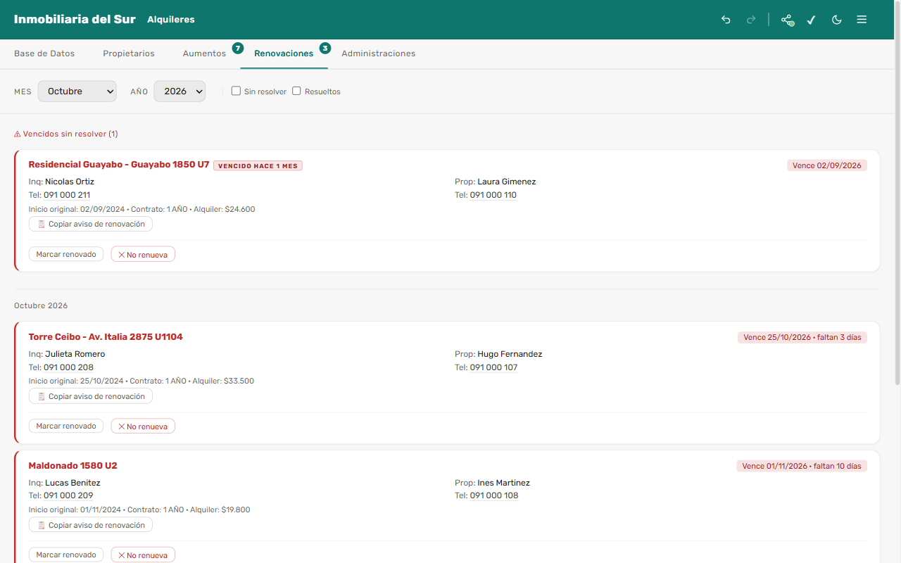
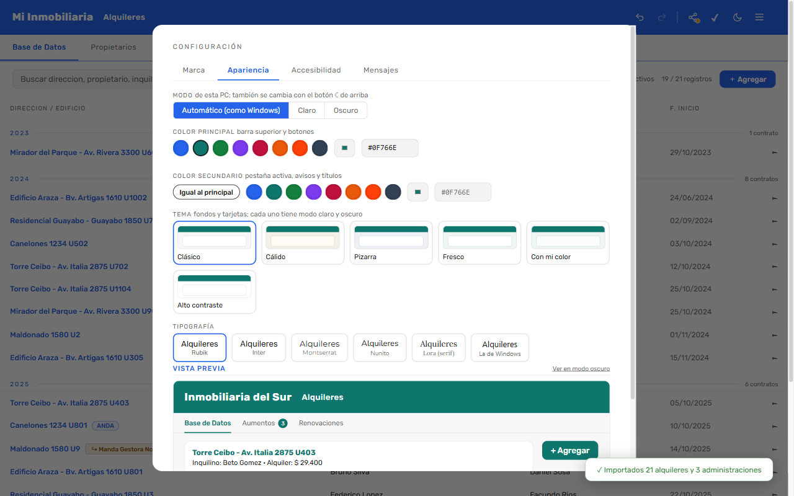
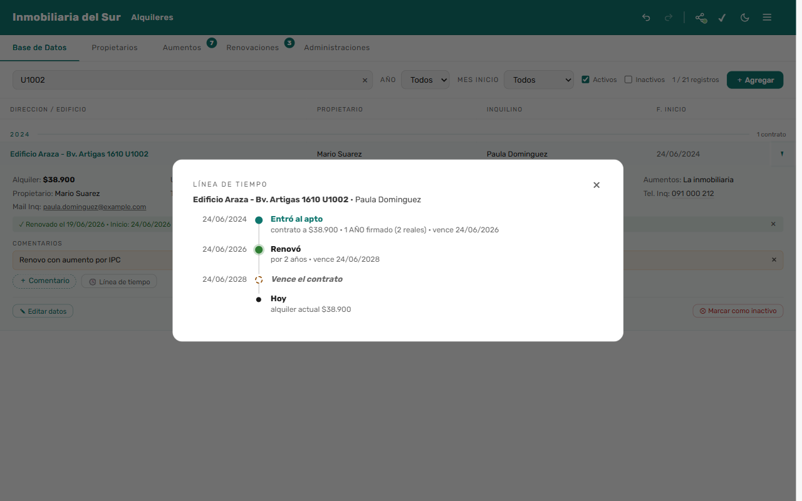
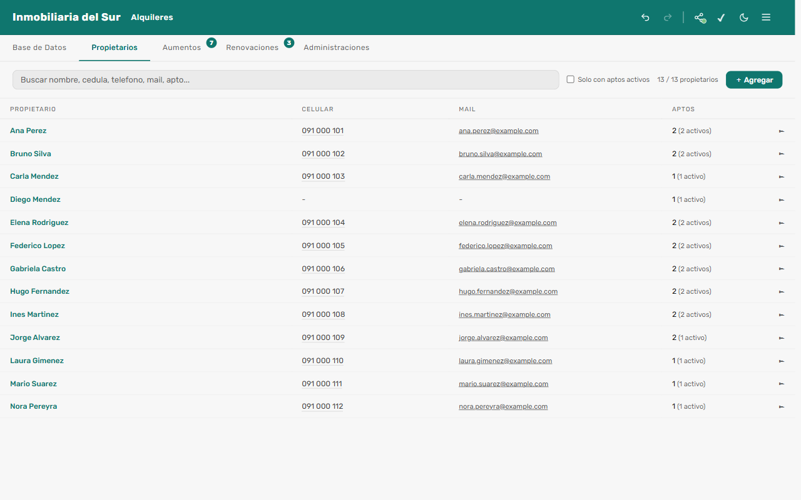
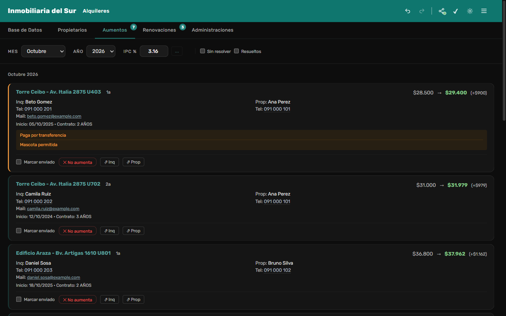

# Admin Alquileres

App de escritorio para que una inmobiliaria administre sus alquileres: contratos, propietarios,
administraciones de edificios, **aumentos por IPC** y **renovaciones** de contratos, con los mensajes
listos para mandar por WhatsApp. Cada inmobiliaria la configura con su nombre, logo y color.



> Nació como herramienta interna de una inmobiliaria de Montevideo, donde se usa todos los días, y
> se está convirtiendo en una versión general. El historial está en el [CHANGELOG](CHANGELOG.md)
> y cada versión tiene su tag (`v0.1.0`, `v0.2.0`…).

## Qué hace

| | |
|---|---|
| **Base de datos** | Alquileres agrupados por año de inicio y búsqueda por dirección, propietario, inquilino o teléfono. Cada alquiler tiene una ficha desplegable con todos sus datos, comentarios y teléfonos que abren WhatsApp. |
| **Aumentos** | Qué contratos aumentan cada mes (aniversario o último aumento) y el importe nuevo según el IPC, que se descarga del INE. Incluye los mensajes para inquilino y propietario. Al marcarlo como enviado queda registrado. |
| **Renovaciones** | Contratos que vencen en los próximos 45 días, vencidos sin resolver, "no renueva" y renovados. El aviso de renovación queda listo para copiar. |
| **Línea de tiempo** | Para cada alquiler: cuándo entró, cuándo venció, cada renovación y el próximo vencimiento. |
| **Propietarios** | Dueños y copropietarios (se separan solos desde "A / B"), la persona de contacto con quien se habla, documentos y cuentas de cobro por apartamento. |
| **Garantías y delegados** | Los contratos cuyos aumentos los gestiona la garantía (CGN, ANDA) o un tercero quedan fuera de las listas de trabajo. |
| **Visor** | Una segunda instalación de solo lectura, por ejemplo para el dueño de la inmobiliaria. Lee una copia publicada en una carpeta compartida, se actualiza sola y marca lo nuevo desde la última vez que se miró. |
| **Tu marca** | Nombre, logo, color principal y secundario, seis temas (cada uno en claro y oscuro), seis tipografías e ícono de la app (prediseñado con tu color, tu logo o una imagen propia). Toda la interfaz se pinta con esos colores cuidando el contraste. La primera vez que se abre, un asistente guía estos pasos. |
| **Accesibilidad** | Tamaño del texto y la interfaz (90 % a 150 %), negrita, más contraste, más espacio entre letras y renglones, subrayar enlaces y menos animaciones. Modo claro u oscuro automático según Windows. Todas las pantallas cumplen WCAG 2.1 AA en las pruebas automáticas. |
| **Mensajes** | Plantillas editables para los avisos de aumento y renovación, con datos que se completan solos. |
| **Importar** | Planilla modelo de Excel o CSV, con columnas reconocidas por su nombre. Al empezar, o con la app en uso: sumarla a lo que ya hay (sin repetir) o reemplazar todo. |
| **Cuidado de los datos** | Guardado automático, deshacer/rehacer (Ctrl+Z / Ctrl+Y), copias de respaldo rotativas y exportación a CSV. |

<table>
<tr>
<td></td>
<td></td>
</tr>
<tr>
<td></td>
<td></td>
</tr>
<tr>
<td></td>
<td></td>
</tr>
</table>

## Probarla

Requiere [Node.js](https://nodejs.org/) 24.

```bash
npm install
npm start
```

En la primera pantalla elegí **"Probar con datos de ejemplo"**. Carga una inmobiliaria inventada con fechas
calculadas desde hoy, así todas las pestañas tienen algo para ver.

## Cómo está hecha

- **Electron** (proceso principal y ventana con aislamiento de contexto) y **SQLite** en memoria con
  [sql.js](https://sql.js.org/). En cada cambio la base se guarda a disco de forma atómica (archivo
  temporal y luego renombrado).
- JavaScript con módulos ES, sin frameworks de interfaz ni paso de compilación.
- Tres capas:

```
src/
  dominios/        Reglas de negocio puras (sin Electron ni base de datos): aumentos, vencimientos,
                   línea de tiempo, propietarios, direcciones, marca y paleta de colores, mensajes,
                   planilla de importación y datos de ejemplo. Se prueban con node:test.
  infraestructura/ Proceso principal: base de datos, migraciones, canales con la ventana,
                   publicación para el Visor, importación de Excel/CSV y descarga del IPC.
  interfaz/        La ventana: vistas (pestañas), ventanas secundarias y componentes.
```

- La ventana solo se comunica con el proceso principal por los canales definidos en `preload.js`. El
  Visor registra únicamente canales de lectura.
- La marca se guarda dentro de la base, así el Visor muestra la misma que el editor. La paleta
  (barra, acentos y texto sobre el color) se calcula a partir de un solo color, cuidando el contraste
  [WCAG](https://www.w3.org/WAI/WCAG21/Understanding/contrast-minimum.html) en tema claro y oscuro.

## Pruebas

```bash
npm test            # unitarias: reglas de negocio, base de datos e importador
npm run test:e2e    # de punta a punta: abre la app real con Playwright
npm run test:all    # las dos
```

La accesibilidad se revisa automáticamente con [axe-core](https://github.com/dequelabs/axe-core) (WCAG 2.1 A y AA):
todas las pantallas, con cada tema en modo claro y oscuro, con las opciones de Accesibilidad activadas y con
colores de marca claros. Si un cambio baja el contraste o deja un campo sin etiqueta, la prueba falla.

Las pruebas de punta a punta usan carpetas temporales y datos inventados. Recorren el primer arranque,
los datos de ejemplo, la configuración de la marca y de los mensajes, la planilla modelo (descargar e
importar) y el Visor (el editor publica y el Visor se actualiza solo, en solo lectura).

## Instaladores (Windows)

```bash
npm run dist         # editor  -> dist/
npm run dist:visor   # Visor   -> dist-visor/
npm run smoke        # abre los dos empaquetados y verifica que arranquen
npm run capturas     # regenera las capturas de este README
```

Pensada para inmobiliarias de Uruguay: aumentos por IPC del INE, pesos y dólares, teléfonos uruguayos para WhatsApp.

## Licencia

© 2026 Pablo Rodriguez. Este proyecto se distribuye bajo la licencia
[Creative Commons Atribución-NoComercial-CompartirIgual 4.0 Internacional (CC BY-NC-SA 4.0)](https://creativecommons.org/licenses/by-nc-sa/4.0/deed.es).
El texto completo está en [LICENSE](LICENSE).

[](https://creativecommons.org/licenses/by-nc-sa/4.0/deed.es)

En resumen, podés:

- **Compartir**: copiar y redistribuir el material en cualquier medio o formato.
- **Adaptar**: modificarlo y crear a partir de él.

Siempre que:

- **Atribución**: menciones al autor, incluyas un enlace a la licencia e indiques si hiciste cambios.
- **No comercial**: no lo uses con fines comerciales (por ejemplo, venderlo o cobrar por usarlo).
- **Compartir igual**: si lo modificás o creás algo a partir de él, lo distribuyas bajo esta misma licencia.

Este resumen no reemplaza al texto legal. Los componentes de terceros que incluye la app mantienen sus propias
licencias: ver [LICENCIAS-DE-TERCEROS.md](LICENCIAS-DE-TERCEROS.md).
